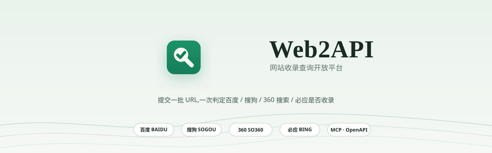

<p align="center"></p>

# Web2API — Self-Hosted Website Index-Check Open Platform

**English** | [简体中文](README.zh-CN.md)

[](LICENSE)
[](go.mod)
[](docs/CONFIGURATION.md)

A **self-hosted, MIT-licensed open platform** that checks whether URLs are indexed by Baidu, Sogou, 360 Search and Bing in one API call — with four-engine raw search, native MCP + OpenAPI agent entries, and a built-in admin console. The website, admin console and all API endpoints are served under a fixed **`/web-tool`** sub-path: the website is the `/web-tool/` root, the console lives at `/web-tool/console/`.

---

## Table of Contents

- [1. Why Web2API](#1-why-web2api)
- [2. How Index-Check Works](#2-how-index-check-works)
- [3. Quick Start](#3-quick-start)
- [4. Quick Start for Agents](#4-quick-start-for-agents)
- [5. API Overview](#5-api-overview)
- [6. Agent Integrations (MCP + OpenAPI)](#6-agent-integrations-mcp--openapi)
- [7. IP Risk Control & Engine Cooldown](#7-ip-risk-control--engine-cooldown)
- [8. Security Model](#8-security-model)
- [9. Raw Mode (Honest Notes)](#9-raw-mode-honest-notes)
- [10. Legacy Assets Notice](#10-legacy-assets-notice)
- [11. Self-Hosting & Deployment](#11-self-hosting--deployment)
- [12. Configuration](#12-configuration)
- [13. Testing](#13-testing)
- [14. Project Structure](#14-project-structure)
- [15. License](#15-license)

**Documentation**:

| Document | Content |
| --- | --- |
| [docs/QUICKSTART.md](docs/QUICKSTART.md) | Full 5-minute walkthrough (Chinese): login → create key → first index check → read quota |
| [docs/API.md](docs/API.md) | Full endpoint reference: requests/responses, error codes, rate limits, billing (Chinese) |
| [docs/AGENT-README.md](docs/AGENT-README.md) | 5-minute agent integration guide: MCP / OpenAPI / REST (Chinese) |
| [docs/ARCHITECTURE.md](docs/ARCHITECTURE.md) | Architecture: dual-channel, index-check pipeline, resilience & anti-scraping (Chinese) |
| [docs/CONFIGURATION.md](docs/CONFIGURATION.md) | Configuration reference, key by key (Chinese) |
| [docs/TESTING.md](docs/TESTING.md) | Testing design and usage (Chinese) |
| [docs/CONTRIBUTING.md](docs/CONTRIBUTING.md) | Contributing guide (Chinese) |
| [deploy/README.md](deploy/README.md) | Deployment & ops: Docker Compose, probes, troubleshooting (Chinese) |

---

## 1. Why Web2API

This is **not** a general-purpose API gateway, nor another SerpAPI clone. The moat is in two places: the **index-check semantics for the four Chinese-market engines** (search with the URL itself as the query + redirect-link resolution + normalized matching — a niche SerpAPI/Serper/Bocha don't offer) and **engine anti-scraping countermeasures** (desktop fingerprints, dual-channel fallback, CAPTCHA gating, rate limiting, circuit breaking, and an IP cooldown state machine). Relaying and orchestration are just the shell.

**Features at a glance**:

- **Index-check API**: `POST /web-tool/v1/index/check` takes up to 20 URLs per request and returns per-engine `indexed` verdicts with match details; 1 URL × 1 engine = 1 unit.
- **Four-engine raw search**: `GET /web-tool/{engine}/search` with `format=json|markdown|text|ndjson`.
- **Dual agent entry points**: MCP streamable HTTP (6 tools, incl. batch jobs) + OpenAPI 3.1 spec + an llms.txt capability list.
- **Admin console**: API keys, quotas, usage logs, engine risk-control dashboard, playground, settings.
- **Built-in IP risk control**: desktop browser fingerprints, browser/HTTP dual-channel fallback, CAPTCHA gating, per-engine rate limits, circuit breakers, and an engine cooldown state machine.
- **No external storage dependencies**: a single bbolt file holds all state — no database, no message queue; the build is a single executable (`./web2api serve`; browser mode needs a local Chrome/Chromium/Edge).

What we deliberately **don't** do: no global engine coverage, no Google vertical matrix, no location/language parameters, no async job archival, no reranker add-on layer. Two honest caveats: billing is **per successful unit** — after an HTTP 200 completes, the response envelope is inspected engine by engine and only successful units are charged; engine-level failed units (the `error` field, including raw-mode `not_implemented`) are not billed, and when the envelope cannot be parsed the full requested units are billed (fallback rule); 4xx / 429 / 503 are not billed. Batch index checks are synchronous, capped at 20 URLs per request.

Capability matrix below (✓ = yes, ✗ = no, partial = yes with clear limits). **As of 2026-11, based on vendors' public docs; not independently re-verified**:

| Capability | **Web2API** | SerpAPI | Serper.dev | BochaAI | 5118 | Aizhan | Link113 |
| --- | --- | --- | --- | --- | --- | --- | --- |
| Positioning | **Index check** + CN search | Global SERP API | Google SERP API | AI-native search | SEO big data | Site-level SEO data | Index check |
| Four CN engines (baidu/sogou/so360/bing) SERP | ✓ | Partial (Baidu/Yandex etc., 100+ engines) | ✗ (Google only) | Partial (Web Search covers Chinese web, not engine-parity) | ✗ | ✗ | ✗ |
| **URL index-check API (core semantics)** | **✓** | ✗ | ✗ | ✗ | ✗ (web tool only, 200 URLs per batch, no API) | ✗ | ✓ |
| Self-hosted (keys/logs stored locally) | **✓** (single executable) | ✗ | ✗ | ✗ | ✗ | ✗ | ✗ |
| MCP server (direct client connection) | ✓ (built in) | ✓ (official) | ✗ | ✓ | ✗ | ✗ | ✗ |
| Public OpenAPI spec (Dify/n8n/LangChain import) | ✓ (`/web-tool/openapi.yaml` + `llms.txt`) | ✗ | ✗ | ✗ (docs behind a login-walled Feishu wiki) | ✗ | ✗ | ✗ |
| Async batch / archive / callbacks | ✗ (sync, 20 URLs/request) | ✓ (async + Searches Archive) | ✗ | ✗ | ✓ (taskid polling) | ✗ | ✓ (webhook) |
| Location/language/freshness params | ✗ | ✓ (location/uule/gl/hl…) | Partial | ✓ (freshness) | ✗ | ✗ | ✗ |
| Result format options | Partial (`format=json\|markdown\|text\|ndjson` on search; index endpoint is JSON-only) | ✓ (json/html/md) | ✗ | ✗ | ✗ | ✗ | ✗ |
| Reranker / AI value-add layer | ✗ | ✗ | ✗ | ✓ (Semantic Reranker / AI Search) | ✗ | ✗ | ✗ |
| Structured numeric error codes | ✗ (string `code` + `reason`, see error table) | ✗ | ✗ | ✗ | ✓ (100xxx/200xxx ranges) | — | ✗ |
| Free tier / open source | ✓ (MIT, self-hosting is free) | Trial | 2,500 calls | — | 100 calls free | — | — |
| Billing promise | Successful units only (engine-level failures not charged) | — | Success-only billing | — | Per call | Per call | — |

**Differentiation summary**: SerpAPI/Serper/Bocha sell "search results"; we sell "index verdicts". 5118/Aizhan offer only a web tool or indirect site-level metrics for index checking; Link113 has an index API but no self-hosting, no agent entry points, and no search plane. **"URL index-check API for Chinese engines + self-hosted control + dual agent entry (MCP + OpenAPI)" is a niche no one else occupies today.**

---

## 2. How Index-Check Works

1. **Search**: the target URL itself is the query phrase, retrieving the engine's top 10 results — baidu/sogou/so360 use the full URL; bing tries multiple query forms with early termination (quoted full URL first, then full URL, then scheme-stripped host+path); the first SERP with an exact match wins. The earlier `url:<url>` operator was retired in 2026-11 (it returns unrelated results). Everything runs through the engines' existing search pipeline, so fingerprints, dual-channel, CAPTCHA gating, rate limits and circuit breakers all apply.
2. **Redirect resolution**: redirect links in the candidates (`baidu.com/link?url=`, `sogou.com/link`, `so.com/link`, bing `/ck/a`) are resolved to their real addresses before matching.
3. **Normalized matching**: lowercase scheme and host, drop default ports, drop fragments, drop trailing `/` (except on the root path), percent-decode; when the target URL has no query string the result's query is ignored, otherwise sorted query params must be equal. Equal host and path → `indexed=true` with `match="exact"`; otherwise `indexed=false` with `match="none"`.
4. **Accuracy**: every engine **under-reports when a page is indexed but ranked outside the top 10**; `match="none"` strictly means "not among the top 10 retrieved results", not "not indexed". Root URLs (e.g. `https://example.com`) hit most often; deep links outside the top 10 get missed. We recommend **cross-checking with multiple engines**: any engine returning `indexed=true` confirms the page is indexed.

---

## 3. Quick Start

A local Chrome/Chromium/Edge is required (browser mode is the default).

```bash
go build -o web2api .
./web2api serve          # reads ./config.yaml by default, listens on 127.0.0.1:7000
# Website:        http://127.0.0.1:7000/web-tool/
# Admin console:  http://127.0.0.1:7000/web-tool/console/
```

Or Docker Compose (see [deploy/README.md](deploy/README.md)):

```bash
docker compose -f deploy/docker-compose.yml up -d --build
curl http://127.0.0.1:7000/web-tool/health
```

> `{BASE}` below stands for your service root: `http://127.0.0.1:7000/web-tool` locally, or e.g. `https://your-domain.com/web-tool` once deployed. **Every endpoint lives under the fixed `/web-tool` prefix.**

The default admin is **`admin` / `admin123`** — change the password right after the first deployment, either in the console (`/web-tool/console/`, Settings page) or via `config.yaml`'s `platform.admin_password`. When bound to a non-loopback address with the default `admin123` password, the startup log emits a security warning (loopback-only deployments don't trigger it; `security.data_plane_auth=false` adds a separate data-plane warning). Console login has no CAPTCHA — never expose the admin endpoints to the public internet.

**First call** (after creating an API key on the console's `#/keys` page):

```bash
curl -X POST {BASE}/v1/index/check \
  -H "X-API-Key: <YOUR_API_KEY>" -H "Content-Type: application/json" \
  -d '{"urls":["https://example.com/post-1"],"engines":["baidu","bing"]}'
```

For a step-by-step first integration, see **[docs/QUICKSTART.md](docs/QUICKSTART.md)** (Chinese): login → create key → first index check → read quota in 5 minutes, with real response samples, copy-paste Python/JS/curl code and a troubleshooting table.

---

## 4. Quick Start for Agents

Three steps to your first verdict (full agent guide: [docs/AGENT-README.md](docs/AGENT-README.md), Chinese; hands-on tutorial: [docs/QUICKSTART.md](docs/QUICKSTART.md), Chinese):

```bash
# 1) Log in as admin (default admin / admin123 — change it right after first login)
curl -s -X POST {BASE}/api/auth/login \
  -H "Content-Type: application/json" \
  -d '{"username":"admin","password":"<your-admin-password>"}'
# → {"token":"<ADMIN_JWT>","expires_in":86400,"user":{"username":"admin"}}

# 2) Create an API key (the full key, shaped like sk-w2a-<32-hex>, is returned only once — save it)
curl -s -X POST {BASE}/api/keys \
  -H "Authorization: Bearer <ADMIN_JWT>" -H "Content-Type: application/json" \
  -d '{"name":"my-agent","daily_quota":100}'
# → {"id":"35b1b68658b1dda8","prefix":"sk-w2a-f3a0c0","key":"<YOUR_API_KEY>",…}

# 3) First index check
curl -s -X POST {BASE}/v1/index/check \
  -H "X-API-Key: <YOUR_API_KEY>" -H "Content-Type: application/json" \
  -d '{"urls":["https://github.com"],"engines":["baidu","bing"]}'
# → results[].engines.<engine> carries indexed / match / matched_result_url per engine
```

**Reading the result**: `indexed:true` = the URL was found among that engine's top 10 results; `indexed:false` (`match:"none"`) strictly means "not in the top 10", **not "not indexed"** — pages indexed but ranked lower (deep links especially) are missed, so cross-check with multiple engines (any engine returning `indexed:true` confirms it is indexed). Billing = URL count × engine count in units; only successful units are charged.

One-line MCP setup (Claude Code):

```bash
claude mcp add --transport http web2api {BASE}/mcp --header "X-API-Key: <YOUR_API_KEY>"
```

---

## 5. API Overview

Three planes:

| Plane | Endpoints | Auth | In one line |
| --- | --- | --- | --- |
| Data plane | `/web-tool/v1/*`, `/web-tool/{engine}/search` | `X-API-Key` (search is anonymous only when `data_plane_auth:false`; the bundled config template defaults to `true`, key required) | Index check + four-engine search with quotas, rate limits and cooldowns built in |
| Agent plane | `/web-tool/mcp`, `/web-tool/openapi.yaml`, `/web-tool/llms.txt` | `X-API-Key` or JWT | First-class agent access: Claude/Dify/n8n/LangChain via two entry points |
| Control plane | `/web-tool/api/*` + `/web-tool/console/` console | JWT | Governance console: keys, quotas, usage logs, engine cooldown dashboard, playground |

All paths are prefixed with `/web-tool`; real request/response/error samples live in **[docs/API.md](docs/API.md)** (Chinese).

```text
Data plane (X-API-Key)
  POST /web-tool/v1/index/check    batch index check (≤20 URLs sync; >20 → 202 job, 1 URL×1 engine = 1 unit)
  GET  /web-tool/v1/index/check/jobs/{id}          job progress (status/progress/eta_seconds)
  GET  /web-tool/v1/index/check/jobs/{id}/results  job results (?format=csv to download)
  DELETE /web-tool/v1/index/check/jobs/{id}        cancel a queued/running job
  GET  /web-tool/v1/index/check    single-URL convenience variant
  GET  /web-tool/v1/quota          quota lookup
  GET  /web-tool/v1/engines        engines and circuit-breaker state
  GET  /web-tool/{baidu|sogou|so360|bing}/search?text=…   four-engine raw search (auth follows security.data_plane_auth: template default requires X-API-Key)

Agent plane
  POST /web-tool/mcp               MCP streamable HTTP (initialize/tools, 6 tools)
  GET  /web-tool/openapi.yaml      OpenAPI 3.1 spec
  GET  /web-tool/llms.txt          agent capability list

Control plane (JWT)
  /web-tool/api/auth/login|password, /web-tool/api/keys, /web-tool/api/stats/*,
  /web-tool/api/usage, /web-tool/api/engines (cooldown state machine),
  /web-tool/api/engines/{name}/cooldown/reset|force,
  /web-tool/api/playground/check (console playground, not billed)

Health & observability (no auth)
  /web-tool/health, /ready, /stats, /stats/cache|proxy|cb
```

---

## 6. Agent Integrations (MCP + OpenAPI)

### Claude Code (MCP, one line)

```bash
claude mcp add --transport http web2api {BASE}/mcp --header "X-API-Key: <YOUR_API_KEY>"
```

### Generic JSON config (Claude Code `.mcp.json` / Cursor / VS Code, etc.)

```json
{
  "mcpServers": {
    "web2api": {
      "type": "http",
      "url": "{BASE}/mcp",
      "headers": { "X-API-Key": "<YOUR_API_KEY>" }
    }
  }
}
```

Claude Desktop adds remote MCP servers through its Connectors UI; ChatGPT, Codex and VS Code Copilot — clients that already support remote MCP (streamable HTTP) — can connect per their own documentation, and other clients should check their docs for remote-transport support. Config field names differ slightly between clients; follow each client's documentation.

Once connected, agents can call 6 tools directly: `web_search` (four-engine search, 1 unit/call), `check_indexed` (index check, urls×engines units; over 20 URLs it queues an async job and returns a `job_id`), `get_index_job` (job progress/results), `cancel_index_job` (cancel a job), `get_quota` (quota), `list_engines` (engines and cooldown state). The protocol is MCP streamable HTTP, JSON-RPC 2.0, protocolVersion `2025-06-18`, with in-memory `Mcp-Session-Id` sessions. **An API key is mandatory** — unauthenticated requests get 401.

### Dify / n8n / LangChain (OpenAPI import)

All three platforms use the OpenAPI spec as the common entry: Dify "Custom tool → import OpenAPI", n8n "HTTP Request node → import cURL/OpenAPI", LangChain "OpenAPI toolkit". Configure a **header-type API key** everywhere, header name `X-API-Key` (choose Header Auth in n8n). Spec address: `{BASE}/openapi.yaml`.

Per-platform screenshot-level steps, JSON-RPC payloads and common pitfalls: **[docs/AGENT-README.md](docs/AGENT-README.md)** (Chinese).

---

## 7. IP Risk Control & Engine Cooldown

Chinese engines are extremely sensitive to high-frequency access from a single egress IP. The platform ships four escalating layers of protection:

1. **Per-engine rate limiting** (`rate_requests/rate_burst`, conservative by default) — the first gate.
2. **CAPTCHA gating + dual channel** — after a block, the engine prefers the pure-HTTP channel for 10 minutes (`core/captcha_gate.go`); optional 2captcha auto-solving (see config.yaml comments).
3. **Circuit breaker** — 8 consecutive failures open the circuit, half-open after 20 s (`circuit_breaker` section). Targets **technical failures**.
4. **Engine cooldown state machine** (`stability.engine_cooldown` section) — targets **anti-scraping blocks**, independent per engine:
   - **Trigger**: the engine returns blocked (403) / 429 / captcha. **Behavioral note: the moment a browser CAPTCHA page appears, the cooldown starts** — even if that request is eventually solved, a 10-minute cooldown applies at minimum. This is deliberate: a CAPTCHA means the IP is flagged; hammering on only deepens the ban.
   - **Escalation**: 1st cooldown 10 min, 2nd 30 min, 3rd and beyond 120 min (`steps_minutes: [10,30,120]`).
   - **Reset**: after 240 consecutive minutes without a block (`reset_after_minutes`), the counter resets to tier 1.
   - **During cooldown**: all search/check calls to that engine **fail fast (HTTP 503 `engine_cooldown` envelope + `Retry-After`) without touching the real engine** — no engine quota, proxy or browser resources consumed.
   - **Expiry probe**: when the cooldown expires one probe request is let through — success recovers the engine; another block advances to the next tier; other failures (e.g. timeouts) postpone by the current tier's duration.
   - **Operator override**: `POST /web-tool/api/engines/{name}/cooldown/reset` force-recovers, `POST /web-tool/api/engines/{name}/cooldown/force {"minutes":N}` force-cools for a maintenance window; the console's Engines page (10 s polling) shows countdowns with the same buttons.

Cooldown and circuit breaking are two independent mechanisms; the cooldown check runs first. The `meta.engines_cooldown` field on `/v1` and search responses lists currently-cooling engines — clients should skip those and retry after `Retry-After`.

**A single egress IP cannot sustain long high-concurrency runs** — for sustained use configure a proxy pool (`proxies` section, tagged pools and sticky lanes supported) or lower the frequency.

---

## 8. Security Model

- **Credential storage**: admin password stored as a bcrypt hash (settings bucket, overwriting the config default once changed); API keys stored as SHA-256 hashes only, the full key returned exactly once at creation; JWT signing key is 32 random bytes stored at `<data_dir>/secret.key` (0600).
- **Login brute-force protection**: 5 consecutive failures for the same username+IP lock it for 15 minutes (`security.login_lockout.{fails:5,minutes:15}`); during the lockout every attempt gets `429 {"error":"too_many_attempts"}` + `Retry-After`.
- **Admin API rate limit**: 60 req/min by default (`security.admin_rate_per_minute`), exceeding it returns 429 + `Retry-After`.
- **Token versioning**: changing the password (`POST /web-tool/api/auth/password`, new password ≥ 8 chars) bumps `token_version`, **immediately invalidating all old JWTs (console sessions and MCP Bearer sessions alike)**.
- **Transport**: CORS is open by default, but non-loopback binding combined with no-auth configurations emit startup warnings; in production bind to loopback, tighten `cors.allow_origins`, or put nginx + TLS in front.
- **Storage**: bbolt (pure Go, no CGO) single file `<data_dir>/web2api.db`; if a second process holds the data directory, startup fails outright (fail-closed, preventing split-brain accounting); other open failures fall back to an equivalent JSON file store (same interface; the `/health` `storage` field exposes the actual type).

---

## 9. Raw Mode (Honest Notes)

`server.raw_requests: true` (or `--raw`) switches to pure-HTTP mode: no browser, lower resource use — but the upstream result is **explicitly unstable or possibly unusable** (the startup log warns), and only baidu/sogou/so360 are covered (no bing). More importantly, raw engines **do not support index checks** — under raw mode every unit of `/web-tool/v1/index/check` returns `{"error":{"code":"not_implemented",…}}` (HTTP still 200). Those pseudo-units are **not billed** — under per-successful-unit accounting `not_implemented` is a failed unit, so you don't "pay for not_implemented" — but the results have no value. Raw index-check support is on the roadmap (p1); until then use the default browser mode for index checks.

---

## 10. Legacy Assets Notice

`examples/` and `skills/web2api-search/` are **leftovers from the previous generation**: their scripts point at `/mega/search`, `/extract`, Google/DuckDuckGo engines and other endpoints **that no longer exist on the current API surface**, were not updated with this contract, and cannot be run as-is. This README and [docs/API.md](docs/API.md) are the source of truth (fixing the samples is on the backlog). Treat them as historical reference only — do not copy their URLs or fields.

---

## 11. Self-Hosting & Deployment

The whole application **is always deployed under the `/web-tool` sub-path** (the constant `core.BasePath` in code — not a config option, root mounting unsupported). The root path `/` has no routes (404); `/health`, `/v1/*`, `/api/*`, `/mcp`, `/{engine}/search` exist only under the prefix — container probes and reverse proxies must use prefixed paths such as `/web-tool/health`.

**nginx passthrough (no prefix stripping)**:

```nginx
location /web-tool/ {
    proxy_pass http://127.0.0.1:7000;   # pass through as-is, no path rewrite
    proxy_set_header Host $host;
    proxy_read_timeout 120s;
}
```

A `proxy_pass` target **without a trailing slash** does not rewrite the path; the website and console reference assets with relative paths and hash routing, so no extra configuration is needed. Docker Compose orchestration, container probes, logs and troubleshooting (container `serp`, image `web2api:local`) are covered in [deploy/README.md](deploy/README.md).

---

## 12. Configuration

Precedence: **CLI flags > `WEB2API_*` environment variables > `config.yaml` > built-in defaults** (Viper). Key-by-key comments are in the root [config.yaml](config.yaml); the full reference is [docs/CONFIGURATION.md](docs/CONFIGURATION.md) (Chinese). Platform-related sections (field names fixed):

```yaml
platform:
  enabled: true           # false unmounts /api/* and /v1/*; website, console statics and health endpoints remain
  data_dir: "./data"      # bbolt web2api.db + JWT secret.key live here (data/ is gitignored)
  admin_username: "admin"
  admin_password: "admin123"  # change this right after deployment
  jwt_expire_hours: 24

stability:                # engine cooldown state machine
  engine_cooldown:
    steps_minutes: [10, 30, 120]   # cooldown minutes for the 1st/2nd/3rd+ consecutive block
    reset_after_minutes: 240       # consecutive no-block minutes before the counter resets

security:                 # control-plane hardening
  login_lockout:
    fails: 5              # failure threshold per username+IP
    minutes: 15           # lockout duration
  admin_rate_per_minute: 60  # global admin API rate limit (429 rate_limited beyond)
  data_plane_auth: true      # true also requires X-API-Key on /{engine}/search and /stats/* (bundled template default; the in-code default stays false for existing deployments)
```

Engine and anti-scraping parameters (rate limits, fingerprints, circuit breakers, proxies, 2captcha) are documented in [docs/CONFIGURATION.md](docs/CONFIGURATION.md) and the config.yaml comments.

---

## 13. Testing

```bash
go test ./...                                  # unit tests (offline)
node deploy/e2e.mjs http://127.0.0.1:7000      # platform contract smoke (MCP handshake, cooldown recovery, openapi.yaml/llms.txt assertions)
node deploy/steady-check.mjs http://127.0.0.1:7000 3 20000   # engine steady-state observation
```

Testing design: [docs/TESTING.md](docs/TESTING.md).

## 14. Project Structure

```text
baidu/ sogou/ so360/ bing/   four engines (URL building, selectors, parsing, dual channel, index_check entry)
core/                        HTTP service (all routes under /web-tool), index-check core, browser pool,
                             proxies, cache, circuit breakers, response building, error contract
mcp/                         MCP streamable HTTP endpoint and the 6 tools (agent plane)
platform/                    platform backend: API keys/quotas/usage (bbolt), JWT issuer,
                             /v1 and /api route registration, billing and rate limiting
web/site/                    product website (pure static, zero deps, served at /web-tool/ root)
web/admin/                   admin console (pure static, zero deps, served at /web-tool/console/:
                             Overview/Engines/API Keys/Usage Logs/Playground/Agent Integrations/API Docs/Settings)
cmd/                         CLI (search / serve) and assembly (platform mounting, static panels, startup logs)
deploy/                      Docker orchestration, E2E smoke and steady-state scripts, ops docs
docs/                        API reference, agent guide, architecture, configuration, testing docs
```

## 15. License

This project is open source under the [MIT](LICENSE) license.

Copyright (c) 2026 Web2API contributors

---

> This file is kept in sync with [README.zh-CN.md](README.zh-CN.md); where the docs and the code disagree, the code wins — please open an issue.
