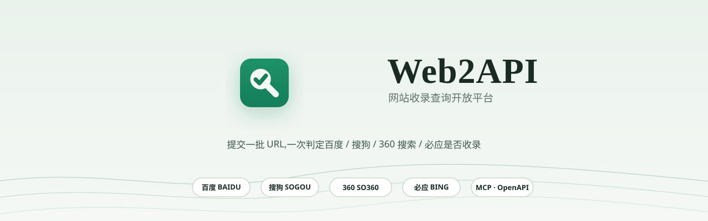

<p align="center"></p>

# Web2API —— 自托管的网站收录查询开放平台

[English](README.md) | **简体中文**

[](LICENSE)
[](go.mod)
[](docs/CONFIGURATION.md)

一个**自托管、MIT 开源**的网站收录查询开放平台：一次 API 调用判定 URL 是否被百度 / 搜狗 / 360 / 必应收录——附四引擎原始搜索、MCP + OpenAPI 双 Agent 入口与内置管理控制台。官网、管理控制台与全部 API 固定部署在 **`/web-tool`** 子路径下：官网即 `/web-tool/` 根，控制台在 `/web-tool/console/`。

---

## 目录

- [1. 为什么做 Web2API](#1-为什么做-web2api)
- [2. 收录判定是怎么做的](#2-收录判定是怎么做的)
- [3. 快速开始](#3-快速开始)
- [4. Agent 快速接入](#4-agent-快速接入)
- [5. API 一览](#5-api-一览)
- [6. Agent 接入（MCP + OpenAPI 双入口）](#6-agent-接入mcp--openapi-双入口)
- [7. IP 风控与冷却机制](#7-ip-风控与冷却机制)
- [8. 安全模型](#8-安全模型)
- [9. raw 模式（如实说明）](#9-raw-模式如实说明)
- [10. 遗留资产声明](#10-遗留资产声明)
- [11. 自托管与部署（子路径）](#11-自托管与部署子路径)
- [12. 配置](#12-配置)
- [13. 测试](#13-测试)
- [14. 项目结构](#14-项目结构)
- [15. 许可证](#15-许可证)

**文档**：

| 文档 | 内容 |
| --- | --- |
| [docs/QUICKSTART.md](docs/QUICKSTART.md) | 5 分钟跑通：登录 → 建钥 → 第一次收录判定 → 查配额（真实响应样例 + 排错表） |
| [docs/API.md](docs/API.md) | 全量端点、请求/响应示例、错误码表、限流与计费口径 |
| [docs/AGENT-README.md](docs/AGENT-README.md) | AI Agent 5 分钟接入（MCP / OpenAPI / REST） |
| [docs/ARCHITECTURE.md](docs/ARCHITECTURE.md) | 架构：双通道编排、收录判定管道、弹性与反爬 |
| [docs/CONFIGURATION.md](docs/CONFIGURATION.md) | 配置参考（逐键默认值） |
| [docs/TESTING.md](docs/TESTING.md) | 测试设计与用法 |
| [docs/CONTRIBUTING.md](docs/CONTRIBUTING.md) | 参与贡献 |
| [deploy/README.md](deploy/README.md) | 部署与运维（Docker Compose、探针、排障） |

---

## 1. 为什么做 Web2API

它**不是**通用 API 网关，也不是又一个 SerpAPI 平替。壁垒在两处：**国内四引擎的收录判定语义**（以 URL 为查询词检索 + 跳转链接还原 + 归一化匹配，这是 SerpAPI/Serper/博查都不提供的细分）与**引擎反爬对抗**（桌面指纹、双通道兜底、验证码门控、限速、熔断、IP 冷却状态机）。转发与编排只是外壳。

**功能一览**：

- **收录判定 API**：`POST /web-tool/v1/index/check` ≤20 条同步返回，>20 条自动转入服务端任务队列（202 + `job_id`，一次可提交上千条，服务端按引擎节奏排队跑完，进度/结果/CSV 走 `/v1/index/check/jobs/{id}`）；逐引擎返回 `indexed` 与匹配详情；1 条 URL × 1 个引擎 = 1 次，计费口径清晰。
- **四引擎原始搜索**：`GET /web-tool/{engine}/search`，`format=json|markdown|text|ndjson`。
- **Agent 双入口**：MCP streamable HTTP（6 个工具，含批量任务）+ OpenAPI 3.1 规范 + llms.txt 能力清单。
- **管理控制台**：API 密钥、配额、用量日志、引擎风控看板、在线调试、系统设置；API 文档为独立页面，侧栏与页脚均可直达。
- **用户角色**：内置 `admin` / `operator` / `viewer` 三级最小权限，按用户库逐请求校验，用户管理与会话撤销仅管理员可用。
- **日志自动清理**：滚动日志 `logs.txt.N` / `audit.log.N` 按 `app.log_retention_days`（默认 30 天）在启动、轮转后与每 12 小时自动按天清理，亦可手动调用 `POST /api/logs/cleanup`。
- **IP 黑名单**：`security.blacklist` 首启种子 IP/CIDR，之后通过控制台/API 管理，命中即 403 并记审计。
- **IP 风控内建**：桌面浏览器指纹、浏览器/HTTP 双通道兜底、CAPTCHA 门控、按引擎限速、熔断保护与引擎冷却状态机。
- **零外部存储依赖**：bbolt 单文件保存全部状态，无数据库、无消息队列；构建产物是单个可执行文件（`./web2api serve`；浏览器模式需本机 Chrome/Chromium/Edge）。

我们先说清楚**不做什么**：不做全球引擎覆盖、不做 Google 垂直矩阵、不做位置/语言参数、不做异步任务归档、没有 reranker 增值层。也如实说明两点：计费口径是**按成功单元计费**——HTTP 200 完成后按响应信封逐引擎核对，仅成功次数扣费；引擎级失败单元（`error` 字段，含 raw 模式 `not_implemented`）不计费，响应信封无法解析时按请求单元全额计费（兜底口径）；4xx / 429 / 503 不计费。批量判定 ≤20 URL 同步返回，>20 条转服务端任务队列（202 + `job_id`，默认上限 5000，进度/结果/CSV 走 `/v1/index/check/jobs/*`），不含任务归档。

下面是功能级矩阵（✓=有，✗=无，部分=有但有明显限制）。**截至 2026-11，基于各家公开资料整理，未逐项复核**：

| 能力 | **Web2API** | SerpAPI | Serper.dev | 博查 BochaAI | 5118 | 爱站 | Link113 |
| --- | --- | --- | --- | --- | --- | --- | --- |
| 定位 | **收录判定** + 国内搜索 | 全球搜索结果 API | Google 搜索结果 API | AI 原生搜索 | SEO 大数据 | 站点级 SEO 数据 | 收录查询 |
| 国内四引擎（baidu/sogou/so360/bing）搜索结果 | ✓ | 部分（含 Baidu/Yandex 等 100+ 引擎） | ✗（仅 Google 系） | 部分（Web Search 覆盖中文 web，非引擎对等） | ✗ | ✗ | ✗ |
| **URL 收录判定 API（本文核心语义）** | **✓** | ✗ | ✗ | ✗ | ✗（仅网页工具，一次 200 条，无 API） | ✗ | ✓ |
| 自托管（密钥/日志本地存储） | **✓**（单可执行文件） | ✗ | ✗ | ✗ | ✗ | ✗ | ✗ |
| MCP server（Claude 系客户端直连） | ✓（本仓库内置） | ✓（官方） | ✗ | ✓ | ✗ | ✗ | ✗ |
| 公开 OpenAPI spec（Dify/n8n/LangChain 导入） | ✓（`/web-tool/openapi.yaml` + `llms.txt`） | ✗ | ✗ | ✗（文档在需登录的飞书 wiki） | ✗ | ✗ | ✗ |
| 异步批量 / 归档 / 回调 | ✗（同步，20 URL/请求） | ✓（async + Searches Archive） | ✗ | ✗ | ✓（taskid 轮询） | ✗ | ✓（Webhook 回调） |
| 位置/语言/时效参数 | ✗ | ✓（location/uule/gl/hl…） | 部分 | ✓（freshness） | ✗ | ✗ | ✗ |
| 结果格式选择 | 部分（search 端点 `format=json\|markdown\|text\|ndjson`；收录端点固定 JSON） | ✓（json/html/md） | ✗ | ✗ | ✗ | ✗ | ✗ |
| Reranker / AI 增值层 | ✗ | ✗ | ✗ | ✓（Semantic Reranker / AI Search） | ✗ | ✗ | ✗ |
| 结构化数字错误码 | ✗（字符串 `code` + `reason`，见错误码表） | ✗ | ✗ | ✗ | ✓（100xxx/200xxx 分段） | — | ✗ |
| 免费额度 / 开源 | ✓（MIT，自托管零费用） | 试用 | 2500 次 | — | 0 元 100 次 | — | — |
| 计费承诺 | 仅成功单元计费（引擎级失败单元不扣费） | — | 仅成功计费 | — | 按次 | 按次 | — |

**差异化结论**：SerpAPI/Serper/博查做"搜索结果"，我们做"收录判定"；5118/爱站在收录上只有网页工具或站点级间接指标；Link113 有收录 API 但无自托管、无 Agent 入口、无搜索平面。**"中文引擎 URL 收录判定 API + 自托管可控 + Agent 双入口（MCP + OpenAPI）"是当前无人同时占据的生态位。**

---

## 2. 收录判定是怎么做的

1. **检索**：以目标 URL 为查询词在引擎内检索前 10 条结果——baidu/sogou/so360 用完整 URL；bing 依次尝试多种查询形式并命中早停（优先带引号的完整 URL，其次完整 URL、去 scheme 的 host+path），任一 SERP 含精确匹配即返回；单一形式均有盲区。bing 早期的 `url:<url>` 语法已于 2026-11 停用（返回无关结果）。全部走各引擎现有搜索管道，桌面指纹、双通道、CAPTCHA 门控、限速、熔断照常生效。
2. **跳转解析**：候选结果里的跳转链接（`baidu.com/link?url=`、`sogou.com/link`、`so.com/link`、bing `/ck/a`）先还原成真实地址，再参与匹配。
3. **归一化匹配**：协议与 host 小写、去默认端口、去 fragment、去尾部 `/`（根路径除外）、百分号解码；目标 URL 无 query 时忽略结果的 query，有 query 时参数排序后须相等。host 与 path 相等 → `indexed=true` 且 `match="exact"`，否则 `indexed=false` 且 `match="none"`。
4. **准确率说明**：所有引擎在**已收录但排名靠后（未进前 10）时会漏报**；`match="none"` 的严格含义是"检索前 10 条结果中没有该页面"，不等于"未收录"。根路径 URL（如 `https://example.com`）命中率最高；带深层路径的 URL 若未进前 10 会漏报。建议对同一 URL **多引擎交叉验证**：任一引擎 `indexed=true` 即可确认已收录。

---

## 3. 快速开始

需要本机装有 Chrome/Chromium/Edge（浏览器模式默认）。

```bash
go build -o web2api .
./web2api serve          # 默认读 ./config.yaml，监听 radar.ydsdoa.cn
# 浏览器打开官网 https://radar.ydsdoa.cn/web-tool/
# 管理控制台入口 https://radar.ydsdoa.cn/web-tool/console/
```

或 Docker Compose（详见 [deploy/README.md](deploy/README.md)）：

```bash
docker compose -f deploy/docker-compose.yml up -d --build
curl https://radar.ydsdoa.cn/web-tool/health
```

> 下文用 `{BASE}` 代表你的服务根地址：本机默认 `https://radar.ydsdoa.cn/web-tool`，部署后如 `https://your-domain.com/web-tool`。**所有端点都挂在 `/web-tool` 固定前缀下。**

默认管理员 **`admin` / `admin123`** —— 首次部署后立即在控制台（`/web-tool/console/`）「系统设置」页改密码，或修改 `config.yaml` 的 `platform.admin_password`。绑定非回环地址且密码仍为默认 `admin123` 时，启动日志会给出安全告警（本机回环部署不触发；`security.data_plane_auth=false` 时另有数据面匿名告警）；控制台登录无验证码，切勿将管理端点暴露到公网。

**第一个调用**（控制台 `#/keys` 页创建一个 API key 后）：

```bash
curl -X POST {BASE}/v1/index/check \
  -H "X-API-Key: <YOUR_API_KEY>" -H "Content-Type: application/json" \
  -d '{"urls":["https://example.com/post-1"],"engines":["baidu","bing"]}'
```

**开发者第一次接入，先看 [docs/QUICKSTART.md](docs/QUICKSTART.md)**：5 分钟跑通「登录 → 建钥 → 第一次收录判定 → 查配额」，含真实响应样例、Python/JS/curl 可复制代码与常见错误排查表。

---

## 4. Agent 快速接入

三步拿到第一次判定结果（Agent 视角完整说明见 [docs/AGENT-README.md](docs/AGENT-README.md)，手把手教程见 [docs/QUICKSTART.md](docs/QUICKSTART.md)）：

```bash
# 1) 管理员登录拿 JWT（默认 admin/admin123，部署后立即改密）
curl -s -X POST {BASE}/api/auth/login \
  -H "Content-Type: application/json" \
  -d '{"username":"admin","password":"<你的管理员密码>"}'
# → {"token":"<ADMIN_JWT>","expires_in":86400,"user":{"username":"admin","role":"admin","user_id":"<用户 ID>"}}

# 2) 创建 API Key（完整密钥形如 sk-w2a-<32位hex>，仅返回这一次，请立即保存）
curl -s -X POST {BASE}/api/keys \
  -H "Authorization: Bearer <ADMIN_JWT>" -H "Content-Type: application/json" \
  -d '{"name":"my-agent","daily_quota":100}'
# → {"id":"35b1b68658b1dda8","prefix":"sk-w2a-f3a0c0","key":"<YOUR_API_KEY>",…}

# 3) 第一次收录判定
curl -s -X POST {BASE}/v1/index/check \
  -H "X-API-Key: <YOUR_API_KEY>" -H "Content-Type: application/json" \
  -d '{"urls":["https://github.com"],"engines":["baidu","bing"]}'
# → results[].engines.<engine> 逐引擎给出 indexed / match / matched_result_url
```

**怎么读结果**：`indexed:true` = 在该引擎前 10 条结果中命中；`indexed:false`（`match:"none"`）严格表示"前 10 条未命中"，**不等于未收录**——已收录但排名靠后（尤其深链接）会漏报，建议多引擎交叉验证（任一引擎 `indexed:true` 即确认已收录）。计费 = URL 数 × 引擎数次，仅成功次数扣费。

MCP 一行接入（Claude Code）：

```bash
claude mcp add --transport http web2api {BASE}/mcp --header "X-API-Key: <YOUR_API_KEY>"
```

---

## 5. API 一览

三个平面：

| 平面 | 端点 | 鉴权 | 一句话 |
| --- | --- | --- | --- |
| 数据平面 | `/web-tool/v1/*`、`/web-tool/{engine}/search` | `X-API-Key`（search 仅当 `data_plane_auth:false` 时免鉴权，模板默认 true 需密钥） | 收录判定 + 四引擎搜索，配额/限流/冷却内建 |
| Agent 平面 | `/web-tool/mcp`、`/web-tool/openapi.yaml`、`/web-tool/llms.txt` | `X-API-Key` 或 JWT | AI Agent 可直接调用：Claude/Dify/n8n/LangChain 双入口接入 |
| 控制平面 | `/web-tool/api/*` + `/web-tool/console/` 控制台 | JWT | 风控与用量治理台：密钥、配额、用量日志、引擎冷却看板、在线调试 |

全部路径以 `/web-tool` 为前缀；请求/响应/错误码真实示例见 **[docs/API.md](docs/API.md)**。

```text
数据平面（X-API-Key）
  POST /web-tool/v1/index/check    批量收录判定（≤20 条同步；>20 条转异步任务 202，1 条 URL×1 个引擎=1 次）
  GET  /web-tool/v1/index/check/jobs/{id}          任务进度（status/progress/eta_seconds）
  GET  /web-tool/v1/index/check/jobs/{id}/results  任务结果（?format=csv 下载表格）
  DELETE /web-tool/v1/index/check/jobs/{id}        取消任务
  GET  /web-tool/v1/index/check    单 URL 便捷版
  GET  /web-tool/v1/quota          配额查询
  GET  /web-tool/v1/engines        引擎与熔断状态
  GET  /web-tool/{baidu|sogou|so360|bing}/search?text=…   四引擎原始搜索（鉴权随 security.data_plane_auth：模板默认需 X-API-Key）

Agent 平面
  POST /web-tool/mcp               MCP streamable HTTP（initialize/tools，6 个工具）
  GET  /web-tool/openapi.yaml      OpenAPI 3.1 全端点规范
  GET  /web-tool/llms.txt          Agent 能力清单

控制平面（JWT；括号内为最小角色；不足 → 403 insufficient_role）
  viewer+：/api/me（含 role/user_id）、/api/keys GET、/api/stats/*、/api/usage、
           /api/audit、/api/engines、/api/sessions GET、/api/logs、/api/logs/config、/api/playground/check
  operator+：/api/keys 增删改与轮换、/api/engines/{name}/cooldown/reset|force、/api/blacklist CRUD
  admin：/api/users CRUD 与 /api/users/:id/password、DELETE /api/sessions/:id、
         POST /api/logs/cleanup、GET /api/admin/backup
全站黑名单守卫命中 → 403 reason=blacklisted（先于其它中间件）。

健康观测（免鉴权）
  /web-tool/health、/ready、/stats、/stats/cache|proxy|cb
```

---

## 6. Agent 接入（MCP + OpenAPI 双入口）

### Claude Code（MCP，一行接入）

```bash
claude mcp add --transport http web2api {BASE}/mcp --header "X-API-Key: <YOUR_API_KEY>"
```

### 通用 JSON 配置（Claude Code `.mcp.json` / Cursor / VS Code 等）

```json
{
  "mcpServers": {
    "web2api": {
      "type": "http",
      "url": "{BASE}/mcp",
      "headers": { "X-API-Key": "<YOUR_API_KEY>" }
    }
  }
}
```

Claude Desktop 经 Connectors 界面添加远程 MCP；ChatGPT、Codex、VS Code Copilot 等已支持远程 MCP（streamable HTTP）的客户端可按各自文档接入，其余客户端以各自文档的远程传输支持为准。各客户端配置字段名略有差异，以各自文档为准。

接入后 Agent 可直接调用 6 个工具：`web_search`（四引擎搜索，每次调用计 1 次）、`check_indexed`（收录判定，按 URL 数 × 引擎数计次；超过 20 条自动转异步任务并返回 `job_id`）、`get_index_job`（任务进度/结果）、`cancel_index_job`（取消任务）、`get_quota`（配额）、`list_engines`（引擎与冷却状态）。协议为 MCP streamable HTTP，JSON-RPC 2.0，protocolVersion `2025-06-18`，支持 `Mcp-Session-Id` 内存会话。**鉴权二选一：API Key（按单元计费）或绑定有效会话的管理员 JWT（必须含 sid，逐请求按用户库复核角色/状态）**；operator/viewer JWT 返回 403 `insufficient_role`，无鉴权请求返回 401；管理员 JWT 调用不计入任何 API Key 配额。

### Dify / n8n / LangChain（OpenAPI 导入）

三个平台都以 OpenAPI spec 为通用入口：Dify「自定义工具 → 导入 OpenAPI」、n8n「HTTP Request 节点 → 导入 cURL/OpenAPI」、LangChain「OpenAPI toolkit」。鉴权统一配 **Header 型 API Key**，Header 名 `X-API-Key`（n8n 选 Header Auth）。spec 地址：`{BASE}/openapi.yaml`。

五分钟跑通的逐平台截图级步骤、JSON-RPC 报文与常见坑见 **[docs/AGENT-README.md](docs/AGENT-README.md)**。

---

## 7. IP 风控与冷却机制

国内引擎对单出口 IP 的高频访问极为敏感。平台内置四层递进的保护：

1. **按引擎限速**（`rate_requests/rate_burst`，默认保守）——第一道闸。
2. **CAPTCHA 门控 + 双通道**——被拦后 10 分钟内该引擎优先走纯 HTTP 通道（`core/captcha_gate.go`）；可选接入 2captcha 自动解题（见 config.yaml 注释）。
3. **熔断器**——连续请求失败 8 次熔断、20 秒后半开（`circuit_breaker` 节）。针对**技术性失败**。
4. **引擎冷却状态机**（二期新增，`stability.engine_cooldown` 节）——针对**反爬拦截**，每引擎独立：
   - **触发**：引擎返回 blocked（403）/ 429 / captcha。**行为级提示：浏览器验证码页一旦出现即触发冷却**——哪怕那次请求最终解题成功，最短也会进入 10 分钟冷却。这是刻意设计：出现验证码意味着 IP 已被标记，继续打只会加深封禁。
   - **连续升级**：第 1 次冷却 10 分钟、第 2 次 30 分钟、第 3 次及以上 120 分钟（`steps_minutes: [10,30,120]`）。
   - **计数归零**：连续无拦截达 240 分钟（`reset_after_minutes`）后计数清零，重新从第 1 档起算。
   - **冷却期内**：该引擎所有 search/check **快速失败（HTTP 503 `engine_cooldown` 信封 + `Retry-After`），不发真实请求**——不消耗引擎配额、代理与浏览器资源。
   - **到期探测**：冷却到期放行一个探测请求——成功即恢复；再次被拦截进下一档；其他失败（如超时）按当前档时长顺延重试。
   - **运维干预**：`POST /web-tool/api/engines/{name}/cooldown/reset` 强制恢复、`POST /web-tool/api/engines/{name}/cooldown/force {"minutes":N}` 维护窗口强制冷却；控制台「引擎状态」页（10 秒轮询）提供冷却倒计时与同款按钮。

冷却与熔断是两套独立机制，冷却检查在前。`/v1` 与 search 响应的 `meta.engines_cooldown` 会列出当前冷却中的引擎，客户端应据此跳过并在 `Retry-After` 后重试。

**单出口 IP 无法支撑长时间高并发**——长期使用请配置代理池（`proxies` 节，支持 tagged pool 与 sticky lanes）或降低频率。

---

## 8. 安全模型

- **凭据存储**：管理员密码 bcrypt 哈希（settings 桶，修改密码后覆盖 config 默认值）；API key 只存 SHA-256 哈希，完整 key 仅创建响应返回一次；JWT 签名密钥为随机 32 字节，存 `<data_dir>/secret.key`（0600）。
- **登录防爆破**：同一用户名（跨来源 IP）连续 5 次失败即锁定 15 分钟（`security.login_lockout.{fails:5,minutes:15}`）；IP 只记入审计，不参与锁定计数，锁定期内正确密码也返回 `429 {"error":"too_many_attempts"}` + `Retry-After`。
- **管理 API 限速**：默认 60 req/min（`security.admin_rate_per_minute`），超限 429 + `Retry-After`。
- **token 版本化**：`POST /web-tool/api/auth/password` 改密后返回新 token、无需重新登录；仅配置管理员（bootstrap admin）改密会 `token_version` +1 并使全部旧 JWT（含 MCP Bearer）失效，其他账号只撤销本人会话。离线 `web2api admin-reset --data-dir <dir> --username admin --password <新密码>` 同时更新 users/settings 桶并递增 `token_version`。
- **传输**：CORS 默认放开但非回环绑定 + 无鉴权组合会在启动日志给出告警；生产环境建议绑回环、收紧 `cors.allow_origins` 或前置 nginx + TLS。
- **存储**：bbolt（纯 Go 无 CGO）单文件 `<data_dir>/web2api.db`；数据目录被第二个进程占用时启动直接失败（fail-closed，防双实例分裂记账），其余打开失败自动回退等价 JSON 文件存储（接口不变，`/health` 的 `storage` 字段暴露实际类型）。

---

## 9. raw 模式（如实说明）

`server.raw_requests: true`（或 `--raw`）切换纯 HTTP 模式：不起浏览器、资源占用低，但**上游已明确结果不稳定或可能完全不可用**（启动日志会告警），且仅覆盖 baidu/sogou/so360（无 bing）。更重要的是：raw 引擎**不支持收录判定**——`/web-tool/v1/index/check` 在 raw 模式下每个单元返回 `{"error":{"code":"not_implemented",…}}`（HTTP 仍 200）。这些伪单元**不计费**——按成功单元核算时 `not_implemented` 属失败单元，不会"花钱买 not_implemented"，但结果无使用价值。raw 收录能力在修复清单中（p1）；在那之前，收录判定请使用默认浏览器模式。

---

## 10. 遗留资产声明

`examples/` 与 `skills/web2api-search/` 是**上一代改造遗留**：其中的脚本指向 `/mega/search`、`/extract`、Google/DuckDuckGo 引擎等**当前 API 面已不存在的端点**，未随本期契约更新，不可直接运行。一切以本 README 与 [docs/API.md](docs/API.md) 为准（示例修复已列入后续清单）。阅读时请把它们当历史参考，不要复制其中的 URL 或字段。

---

## 11. 自托管与部署（子路径）

整个应用**固定部署在 `/web-tool` 子路径下**（代码内常量 `core.BasePath`，不是配置项，不支持根挂载）。根路径 `/` 没有任何路由（404），`/health`、`/v1/*`、`/api/*`、`/mcp`、`/{engine}/search` 只存在于前缀之下——容器探针与反向代理一律使用 `/web-tool/health` 等带前缀路径。

**nginx 直接转发（不去前缀）**：

```nginx
location /web-tool/ {
    proxy_pass https://radar.ydsdoa.cn;   # 原样透传，不做路径重写
    proxy_set_header Host $host;
    proxy_read_timeout 120s;
}
```

`proxy_pass` 末尾**不带斜杠**即不重写路径；官网与控制台自身用相对路径引用资源、hash 路由，无需任何额外配置。Docker Compose 编排、容器探针、日志与排障（容器名 `serp`、镜像 `web2api:local`）详见 [deploy/README.md](deploy/README.md)。

---

## 12. 配置

配置优先级：**CLI 参数 > `WEB2API_*` 环境变量 > `config.yaml` > 内置默认值**（Viper）。逐键注释见仓库根 [config.yaml](config.yaml)，完整参考见 [docs/CONFIGURATION.md](docs/CONFIGURATION.md)。平台相关节（字段名固定）：

```yaml
app:
  log_max_mb: 10           # 单文件轮转上限(MB)；0=仅关闭按大小轮转，按天清理仍生效
  log_backups: 5
  log_retention_days: 30   # 按 mtime 清理 logs.txt.N / audit.log.N，0=不按天清理

platform:
  enabled: true           # false 时不挂载 /api/* 与 /v1/*，官网与控制台静态页与健康端点仍可用
  data_dir: "./data"      # bbolt 库 web2api.db + JWT 密钥 secret.key 的目录（.gitignore 已忽略 data/）
  admin_username: "admin"
  admin_password: "admin123"  # 部署后务必修改
  jwt_expire_hours: 24

stability:                # 二期：引擎冷却状态机
  engine_cooldown:
    steps_minutes: [10, 30, 120]   # 连续第 1/2/3+ 次被拦截的冷却时长
    reset_after_minutes: 240       # 连续无拦截达此时长后连续计数归零

security:                 # 二期：控制平面加固
  login_lockout:
    fails: 5              # 同一用户名跨 IP 连续失败次数阈值（轮换来源 IP 不会重置预算）
    minutes: 15           # 锁定时长
  admin_rate_per_minute: 60  # 管理 API 全局限速（超限 429 rate_limited）
  data_plane_auth: true      # 模板与 serve 内置默认均为 true：数据面 /{engine}/search 与 /stats/* 要求 X-API-Key
                             # 须显式设为 false 才匿名开放（兼容既有部署），生产保持 true
  blacklist: []              # 首启种子 IP/CIDR；一次性写入后仅以控制台/API 为准
```

引擎与反爬参数（限速、指纹、熔断、代理、2captcha）说明见 [docs/CONFIGURATION.md](docs/CONFIGURATION.md) 与 config.yaml 内注释。

---

## 13. 测试

```bash
go test ./...                                  # 单元测试（离线）
go test -race -count=1 ./...                   # 竞态检测需 CGO；Windows 无本地 C 编译器时按 docs/TESTING.md 用
                                               # golang:1.26.11-bookworm + Chromium 运行库容器跑（已实测 11 包全绿，日志 qa/features-audit/race-final.log）
node deploy/e2e.mjs https://radar.ydsdoa.cn      # 平台契约冒烟（含 MCP 握手、冷却恢复、openapi.yaml/llms.txt 断言）
node deploy/steady-check.mjs https://radar.ydsdoa.cn 3 20000   # 引擎稳态观测
```

测试设计见 [docs/TESTING.md](docs/TESTING.md)。

## 14. 项目结构

```text
baidu/ sogou/ so360/ bing/   四引擎（URL、选择器、解析、双通道、index_check 入口）
core/                        HTTP 服务（全部路由挂 /web-tool）、收录判定核心、浏览器池、
                             代理、缓存、熔断、响应构建、错误契约
mcp/                         MCP streamable HTTP 端点与 6 个工具（Agent 平面）
platform/                    平台后端：API key/配额/用量（bbolt）、JWT 管理端、
                             /v1 与 /api 路由注册、计费与限速
web/site/                    产品官网（纯静态零依赖，由 serve 挂在 /web-tool/ 根）
web/admin/                   管理控制台（纯静态零依赖，由 serve 挂在 /web-tool/console/：
                             总览/引擎状态/API 密钥/使用日志/在线调试/Agent 集成/API 文档/系统设置）
cmd/                         CLI（search / serve）与装配（platform 挂载、官网与控制台静态、启动日志）
deploy/                      Docker 编排、E2E 冒烟与稳态脚本、运维文档
docs/                        API 参考、Agent 接入、架构、配置、测试文档
```

## 15. 许可证

本项目以 [MIT](LICENSE) 协议开源。

Copyright (c) 2026 Web2API contributors

---

> 本文件与 [README.md](README.md) 内容同步；如文档与代码不一致，以代码为准并提 issue。
